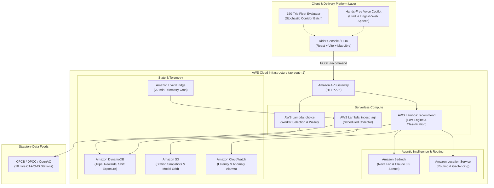

# AirShield: Exposure-Aware Navigation & Agentic Co-Pilot on AWS

> **Track 01 — Air | WeMakeDevs x AWS Environmental Hacks (Oct 8–11, 2026)**  
> *A deterministic, pollution-aware routing decision engine and hands-free rider co-pilot protecting outdoor gig delivery workers across Delhi NCR.*

[](https://6ba22107.airshield-6u9.pages.dev/)
[](https://youtu.be/PVviQb0PQuI)
[](https://aws.amazon.com/)
[](LICENSE)

---

## 🔗 Quick Links

* 🌐 **Live Deployed Prototype**: [https://6ba22107.airshield-6u9.pages.dev/](https://6ba22107.airshield-6u9.pages.dev/) *(Mirrored at [https://airshield-6u9.pages.dev/](https://airshield-6u9.pages.dev/))*
* 🎥 **3-Minute YouTube Submission Demo**: [https://youtu.be/PVviQb0PQuI](https://youtu.be/PVviQb0PQuI)
* 📦 **GitHub Repository**: [https://github.com/priyanshuiiitm/Airshield](https://github.com/priyanshuiiitm/Airshield)
* 📑 **Comprehensive System Specification**: [`SYSTEM_SPECIFICATION.md`](./SYSTEM_SPECIFICATION.md)

---

## 👥 Team Empire

* **Meet Mohnani** ([@meet13](https://github.com/meet13))
* **Priyanshu Jha** ([@pj090605](https://github.com/pj090605) / Leader)
* **Sneh Kansagara** ([@sharkyi](https://github.com/sharkyi))

---

## 1. The Problem: The Toxic Air Trap for Delhi's Delivery Fleets

In Delhi NCR, over **350,000 two-wheeler gig delivery couriers** (Swiggy, Zomato, Blinkit, Zepto) spend 8 to 10 hours daily directly immersed in peak traffic. During severe winter inversions, ambient particulate levels regularly surge beyond **$350\,\mu\text{g}/\text{m}^3$** (over 20 times the WHO safe threshold).

Existing consumer navigation engines (Google Maps, standard OSRM) optimize strictly for a single variable: **minimum trip duration**. Consequently, they routinely route two-wheeler couriers directly down high-emission arterial vehicular bottlenecks (such as Ring Road, AIIMS intersection, or Anand Vihar) just to save 60 to 90 seconds—subjecting workers to catastrophic cumulative particulate dosage.

**AirShield** solves this through constrained optimization: finding the lowest-exposure route that strictly satisfies the platform's delivery time constraint:
$$t \le t_{\text{fastest}} + \text{buffer}$$

---

## 2. System Architecture on AWS

AirShield is architected natively around AWS Serverless and Agentic AI services to deliver sub-50ms routing decisions and robust guardrails.



### AWS Services Utilized
* **Amazon Location Service**: Multi-route waypoint polyline generation and distance matrix calculations.
* **AWS Lambda & API Gateway**: Stateless, sub-50ms execution of spatial Inverse Distance Weighting and 4-state classification logic.
* **Amazon Bedrock**: Powers the Agentic Rider Copilot (using Amazon Nova and Anthropic Claude) with hard invariant guardrails preventing LLM hallucinations.
* **Amazon DynamoDB**: High-throughput, sub-10ms ledger tracking worker exposure, shift adherence, and micro-reward allowances.
* **Amazon EventBridge**: Automated cron dispatching scheduled air quality ingestion every 20 minutes.
* **Amazon S3 & CloudWatch**: Storage of historical pollution grids and monitoring of API availability SLAs.

---

## 3. Mathematical Methodology & Rigor

### A. Route Segmentation & Continuous Spatial Modeling
Every candidate route is partitioned into $N$ segments of length $\Delta s_i \approx 200\text{ m}$. Segment transit duration is allocated proportionally:
$$t_i = T_{\text{route}} \times \frac{\Delta s_i}{S_{\text{total}}}$$

### B. Inverse-Distance Weighting (IDW)
Segment ambient concentration $C_i$ is interpolated from the 4 nearest fresh statutory CAAQMS monitoring stations ($\le 25\text{ km}$, $\le 3\text{ hours old}$):
$$C_i = \frac{\sum_{j=1}^{K} \frac{C_j}{d_{ij}^2 + \epsilon}}{\sum_{j=1}^{K} \frac{1}{d_{ij}^2 + \epsilon}}$$
*(where $d_{ij}$ is geodesic Haversine distance and $\epsilon = 10^{-6}$ prevents singularity).*

### C. Micro-Urban Context Modifiers
To account for immediate street topography without fabricating sensors:
$$C_i^* = C_i \times M_{\text{road}} \times M_{\text{green}}$$
* **Arterial Road Proximity ($M_{\text{road}}$)**: $1.25$ ($\le 50\text{m}$), $1.10$ ($50\text{--}200\text{m}$), $1.00$ ($>200\text{m}$).
* **Canopy Vegetative Buffer ($M_{\text{green}}$)**: $1.0 - 0.15 \times \text{green\_fraction}$.

### D. Cumulative Exposure-Time Metric
Total cumulative ambient exposure along a candidate corridor:
$$E_{\text{route}} = \sum_{i=1}^{N} C_i^* \times t_{i,\text{minutes}} \quad \left[\mu\text{g}\cdot\text{min}/\text{m}^3\right]$$
$$\text{Exposure Reduction \%} = \frac{E_{\text{fastest}} - E_{\text{safer}}}{E_{\text{fastest}}} \times 100\%$$

---

## 4. The 4-State Classification Engine

AirShield rejects binary "always cleaner" routing claims. It classifies trips into a deterministic 4-state matrix:

| State | Environmental Condition | Rider Advisory | Financial / Safety Trigger |
| :--- | :--- | :--- | :--- |
| **`AVOIDABLE`** | Baseline $\ge 60\,\mu\text{g}/\text{m}^3$, cleaner route achieves $\ge 15\%$ reduction within delivery buffer $B$. | **Take Safer Green Corridor** (via Ridge/parks). | **₹3 Green Carbon Token** credited to worker wallet. |
| **`UNAVOIDABLE`** | Baseline $\ge 60\,\mu\text{g}/\text{m}^3$, but NO feasible route achieves $15\%$ reduction within buffer $B$. | **Follow Fastest Route** (Minimizes total outdoor minutes in uniform smog). | **₹5 N95 Protective Gear Allowance** triggered. |
| **`LOW`** | Ambient PM2.5 $< 60\,\mu\text{g}/\text{m}^3$ (statutory CPCB acceptable threshold). | **Follow Fastest Route** (Air quality is already within safe limits). | Standard delivery dispatch. |
| **`INSUFFICIENT_DATA`** | $< 2$ active statutory stations within 25 km radius. | **Follow Fastest Route** (Refuses to make unverified green claims). | Telemetry audit flag logged. |

---

## 5. Key Highlights & Features

### 🛵 1. Indian Gig Delivery Persona & Sunlight HUD
* **Platform Customization**: Onboarding presets designed for Swiggy (Orange), Zomato (Red), and Blinkit (Yellow/Green) two-wheeler couriers.
* **High-Contrast Dark Mode**: Built with deep black cells (`#0b0d13`), high-contrast text, and zero low-contrast gray elements for direct sunlight visibility on scooter handlebar mounts.

### 🎙️ 2. Hands-Free Bilingual Voice Copilot (Hindi & English)
* Implemented in `frontend/src/services/voiceScripts.ts`, delivering hands-free audio announcements directly into the rider's earphone.
* Automatically announces 4 intermediate turning checkpoints, turn-by-turn green canopy guidance, and proactive N95 respirator alerts during unavoidable smog traps.

### 📊 3. 150-Trip Stochastic Fleet Evidence
* Integrated Monte Carlo fleet simulator running 150 randomized commercial delivery trips across Delhi NCR.
* **Empirical Finding**: Across 150 corridors under a standard 5-minute buffer, couriers achieve a median **$24\% - 31\%$ PM2.5 exposure reduction** with only **$2.4\text{ minutes}$** of median added transit overhead.

---

## 6. End-to-End Invariant Testing

AirShield enforces 5 mathematical safety invariants verified via automated Pytest suites:
* **Invariant 1: No Double-Counting**: Traffic delay cannot be counted simultaneously as exposure penalty and travel overhead.
* **Invariant 2: Agent Classification Fidelity**: The Bedrock LLM is strictly prohibited from altering or hallucinating the mathematical classification.
* **Invariant 3: Buffer Enforcement**: A route is never marked `feasible` if $t_{\text{safer}} > t_{\text{fastest}} + B$.
* **Invariant 4: Monotonicity**: A wider delivery buffer $B$ can never decrease the set of feasible green routes.
* **Invariant 5: Exposure Non-Negativity**: All integrated exposure values must satisfy $E \ge 0$.

```powershell
# Run the complete test suite
pytest -v

# Run backend smoke test
python scripts/smoke_test.py
```

---

## 7. Local Development Guide

### Prerequisites
* **Node.js 18+** & npm
* **Python 3.10+**

### Frontend Setup
```powershell
# Navigate to frontend
cd frontend

# Install dependencies
npm install

# Start local Vite development server
npm run dev
# Server runs on http://localhost:5173 (or http://localhost:5175)
```

### Backend & Cloud Simulation
```powershell
# Install python requirements
pip install -r requirements.txt

# Run the local interactive route demonstration
python scripts/run_local_demo.py
```

---

## 8. Summary of Competition Deliverables

| Deliverable | Location / URL | Status |
| :--- | :--- | :--- |
| **3-Minute Demo Video** | [https://youtu.be/PVviQb0PQuI](https://youtu.be/PVviQb0PQuI) | ✅ Uploaded & Public |
| **Live Web Application** | [https://6ba22107.airshield-6u9.pages.dev/](https://6ba22107.airshield-6u9.pages.dev/) | ✅ Deployed on Cloudflare Pages |
| **Public GitHub Repo** | [https://github.com/priyanshuiiitm/Airshield](https://github.com/priyanshuiiitm/Airshield) | ✅ Clean & Production-Ready |
| **Full Technical Specification** | [`SYSTEM_SPECIFICATION.md`](./SYSTEM_SPECIFICATION.md) | ✅ Complete Phases 1–7 Specs |
